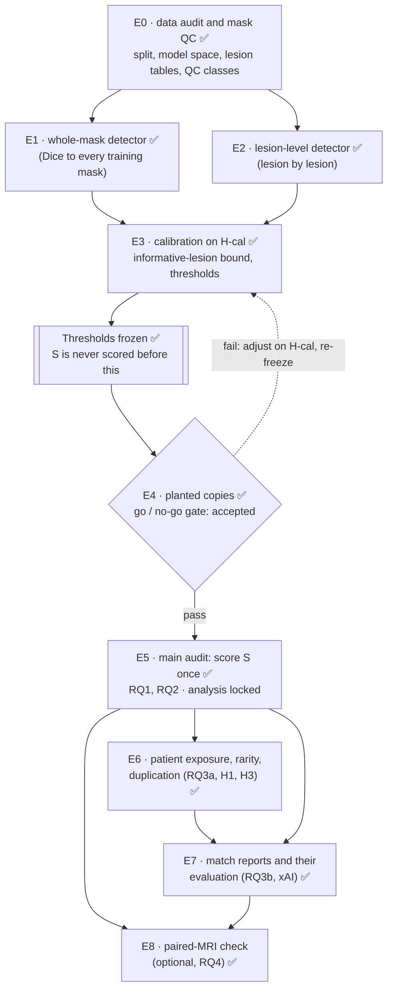
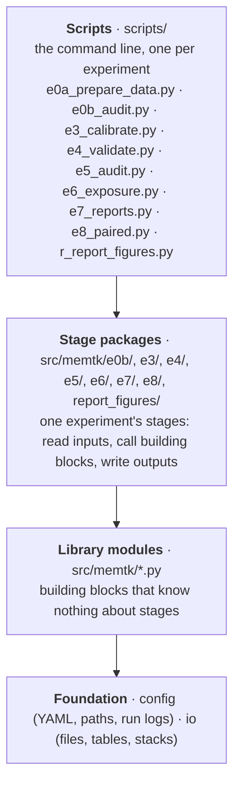

# Architecture

How the project fits together, in one read: what the experiments do and in which order, how the
data flows between them, and how the code is organised. The details live in two reference files:

- `docs/data-dictionary.md`: every file the pipeline reads or writes (path, written by, read by,
  in git, columns), in pipeline order.
- `docs/module-reference.md`: every code module (purpose, main functions, imports and "used
  by", external libraries), the tests, and the planned modules.

*Status (2026-11-16): E0 (E0a + E0b) done and closed; environment pinned in
`requirements-lock.txt`. E1–E3 done: thresholds frozen in `configs/frozen/` (`docs/e1-e3-plan.md`).
E4 (the gate) done (`docs/e4-plan.md`): gate ACCEPTED with a recorded deviation, check 16/16. E5
(the main audit) done (`docs/e5-plan.md`): S scored once with every analysis choice fixed and
locked beforehand; "memorization beyond chance" in multi-lesion masks only, check 26/26. E6 and
E7 done, planned together in `docs/e6-e7-plan.md` (decisions R, U–Z; checks 18/18 and 14/14; plan
closed): the E1 multi-lesion excess reads as typical placement, H1 supported, no exact lesion-level
copy. E8 (optional, lean) done (`docs/e8-plan.md`, decisions AA–AE; check 17/17; plan closed): synthetic MRIs
of the strongest resemblances are not closer to their source slice than chance ("not supported").
Report synthesis and project walkthrough written (`docs/report-synthesis.md`,
`docs/project-walkthrough.md`). Report figures done (`r_report_figures.py` method, results, appendix;
check 17/17) in `results/amibekk_v1/report/`. Next: writing.*

The diagrams are [Mermaid](https://mermaid.js.org/): GitHub renders them; in VS Code install
*Markdown Preview Mermaid Support* (`bierner.markdown-mermaid`) and open the Markdown preview.

---

## 1. The experiments

Nine experiments in a fixed order. The detectors are built and calibrated on held-out patients,
then proved on planted copies, and only then is the synthetic pool S scored, once. Everything
above the freeze never sees S, so nothing can be tuned towards a desired result.

✅ done · yellow: next · dashed: planned. The procedures are in
`docs/experiment-plan.md`.

**The data sets** (all lesion-containing slices in the 128×128 model space): T, the 105
training patients (what the mask generator could have memorized); H-cal, 25 held-out patients
(sets thresholds); H-eval, 26 held-out patients (false-positive check and baseline); S, the
synthetic masks (what is audited; the main audit uses the clean and minor masks).

## 2. How the data flows

| Experiment | Reads | Produces | Used by |
| --- | --- | --- | --- |
| E0a (`e0a_prepare_data.py`) | raw real volumes, raw synthetic pool | patient split; real volumes in model space; index of the synthetic pool | everything after |
| E0b (`e0b_audit.py`) | E0a outputs | brain masks; **lesion tables** (one row per lesion, label maps); **QC classes** of S; E0 statistics | E1–E8 |
| E3 with E1, E2 (`e3_calibrate.py`) | lesion tables of T and H-cal | detector tables for H-cal; **frozen thresholds** (`configs/frozen/`) | E4, E5 |
| E4 (`e4_validate.py`) | frozen thresholds, T, H-eval | planted copies with their provenance; validation table; gate verdict; H-eval detector tables | gate for E5 and its H-eval baseline; E7 |
| E5 (`e5_audit.py`) | frozen thresholds, the E4 gate and H-eval tables, T, H-cal, the planted copies (rehearsal only), S (`score` only) | the E5 file (`configs/frozen/`, values fixed before S); raw detector tables of S; rates against H-eval, tests, groups, near-exact copies; **`flagged.csv`** | E6, E7, E8 |
| E6 (`e6_exposure.py`) | T volumes and lesion tables, E4 H-eval tables, E5's stored tables of S and its mock sets (never scores S) | 3D lesions of T, slice and patient rarity; exposure ratios, the copying-vs-placement reading, H3, H1 | E7 (Panel C, report selection) |
| E7 (`e7_reports.py`) | E4's planted copies and H-eval tables (the generator is checked there first), E5's stored tables of S, E6's exposure | match reports with verdicts; correctness on planted copies; the deletion test; taxonomy | the report |
| E8 (`e8_paired.py`) | E7's report selection (group A), E5's stored tables of S (matched novel masks, sources, shifts), S's MRIs (`paired` only), T BRAVO; H-eval, H-cal and the planted copies for the reference and the rehearsal | image pairs; SSIM in the lesion neighbourhood and whole brain; A vs B judged against H-eval | the report |
| Report figures (`r_report_figures.py`) | the stored tables of E0b–E8 (never re-scores anything) | compact, print-sized figures (PNG + PDF) for the report's sections | the report |

Processed data goes to `processed_data/model_space/<dataset|pool>/` (not in git, regenerated by
the stages); results go to `results/<dataset|pool>/<experiment>/` (in git). Every file, with its
columns: `docs/data-dictionary.md`.

**Inside an experiment: review → decision → production.** Where a setting has to be chosen
from the data, a *review stage* writes the evidence and a proposed value; the user sets the
value in `configs/default.yaml` (with a dated comment); the *production stage* refuses to run
while it is still `null`. E0b used this for decisions A–E; E3 continues with F–H, E4 with I–K,
E5 with L–Q (the config section `audit:`), E6 + E7 with R, U–Z (`exposure:`, `reports:`; S and T
skipped as letters), E8 with AA–AE (`paired:`). The stages of each experiment, in order, are listed in
its plan document and in `scripts/README.md`.

**E5's lock.** E5 is the only experiment that reads S. Its analysis was fixed before S was scored
and rehearsed on mock query sets; `score` wrote a completion marker with the hashes of `audit:` and
both frozen files, after which `prepare` and `score` refuse to run and `analyze` / `check` refuse if
anything changed. E6–E8 only read E5's stored outputs; never change `audit:` or the frozen files.

## 3. How the code is organised

A layer only uses the layers below it. A stage function can be called from a notebook as well
as from its script, e.g. `run_qc(load_config(), overwrite=True)`.

| Library module | What it is for |
| --- | --- |
| `transforms` | the original training transform into the 128×128 model space |
| `split` | the seeded split of patients into T, H-cal and H-eval |
| `synthetic` | reading synthetic samples in place; indexing a pool |
| `lesions` | lesion labelling (attach-or-drop), lesion features, brain masks |
| `ids` | slice keys and lesion IDs shared by every experiment |
| `qc` | quality classes of synthetic masks |
| `plotting` | shared figure helpers and colours (also zoomed label maps: `zoom_window`, `draw_labels`) |
| `checks` | the E0 consistency checks |
| `stages` | shared helpers for stage packages: command-line options, decisions, overwrite guard |
| `wholemask` | E1: the whole-mask detector (Dice with a small shift search) |
| `lesionmatch` | E2: the lesion-level detector (lesion by lesion, Hungarian pairing) |
| `calibration` | E3: chance-match rates, the informative-lesion bound, thresholds with bootstrap-by-patient intervals; for E4 and E5 the frozen files, their settings, both detectors run with them, and the classes they give |
| `sets` | the slice sets as label-map stacks: T, H-cal and H-eval (held-out sets after decision E), a synthetic pool by mask class, the E4 planted set; label maps made again with other attach-or-drop settings |
| `planted` | E4: planted copies P1–P6 of training masks, with the source of every planted lesion |
| `audit` | E5 (and E6, E7): per-slice classes, cluster bootstrap of rates (S by mask, held-out sets by patient), excess with Holm, AUC, standardised rates, chained adjacent-slice groups, copied-area share, held-out maxima; scored sets and the source slice of each flag |
| `lesions3d` | E6: 3D lesions of real volumes (slice-to-slice linking; 26-connectivity as sensitivity) |
| `exposure` | E6: expected shares and exposure ratios, the concentration test, margins, slice and patient rarity, Spearman tests, H1 lesion credits |
| `reports` | E7: match-report data, verdict lines and figures; correctness on planted copies; the deletion test; the taxonomy |
| `paired` | E8: aligning a query image onto a training slice, z-scoring in the brain, lesion-neighbourhood regions, SSIM per region, matched controls |

Functions, imports, "used by" and tests: `docs/module-reference.md`.

**Where things are**

| Folder | Content | In git |
| --- | --- | --- |
| `configs/` | `default.yaml` (datasets, pools, seed, decisions); `frozen/` (the frozen E3 thresholds that E4 and E5 read, and the E5 file fixed before S was scored) | yes |
| `src/memtk/` | the library and stage packages (installed editable: `pip install -e .`) | yes |
| `scripts/` | one entry script per experiment; `README.md` with run order and commands | yes |
| `tests/` | pytest on small hand-built inputs | yes |
| `splits/` | the fixed patient split | yes |
| `results/` | tables, figures, reports and run logs per experiment | yes |
| `processed_data/` | model-space data and caches, regenerated by the stages | no |
| `data/` | raw real data and the synthetic pool, read in place | no |
| `docs/` | plans, notes, this overview and the two reference files | yes |

## 4. Conventions

- **Model space:** every comparison is in the 128×128 space the models saw (per-volume min–max,
  area resize, mask > 0.01). Real data goes through exactly the original transform.
- **IDs:** a slice key is `Mets_005/z127` (real; `z` is the 0-based array index, ITK-SNAP shows
  z + 1) or the sample ID (synthetic: the full file stem, never a number); a lesion ID is
  `<slice key>/L<n>`, L1 the largest. Read pipeline CSVs with `memtk.io.read_table`, which keeps
  IDs as text.
- **Patients, not slices:** split, aggregate and bootstrap by patient.
- **Reproducibility:** one config and one seed (2026); every stage writes a run log (time,
  command, seed, full config, package versions) and refuses to overwrite its outputs without
  `--overwrite`; the environment is pinned in `requirements-lock.txt`.
- **No leakage:** H-cal and H-eval never enter training or threshold fitting beyond their role
  above; S is never scored before the thresholds are frozen, and only once (E5's lock).
- **Chance, not counts:** about 7–10% of any mask set matches a training slice by chance at the
  frozen thresholds; results are excesses over the H-eval rate, and counts of extremes need a
  chance expectation (E5 lesson, report-notes section 4).

## Keeping these documents current

| When | Update |
| --- | --- |
| A stage writes a new file or column | `docs/data-dictionary.md` (index row and entry) |
| A module is added or its functions or imports change | `docs/module-reference.md` |
| An experiment, a layer, a folder or the data flow changes | this file |
| A stage is added | also `scripts/README.md` (status table and commands) |
