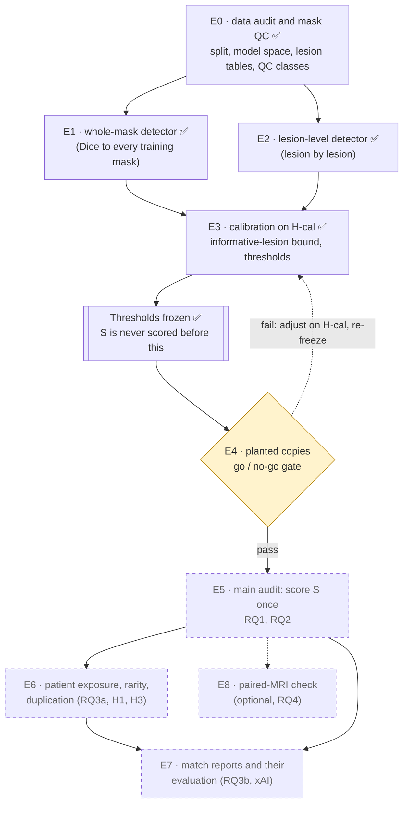
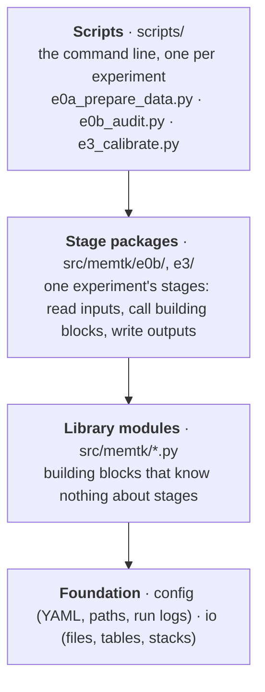

# Architecture

How the project fits together, in one read: what the experiments do and in which order, how the
data flows between them, and how the code is organised. The details live in two reference files:

- `docs/data-dictionary.md`: every file the pipeline reads or writes (path, written by, read by,
  in git, columns), in pipeline order.
- `docs/module-reference.md`: every code module (purpose, main functions, imports and "used
  by", external libraries), the tests, and the planned modules.

*Status (2026-11-03): E0 (E0a + E0b) done and closed; environment pinned in
`requirements-lock.txt`. E1–E3 done: thresholds frozen in `configs/frozen/` (`docs/e1-e3-plan.md`).
E4 (the gate) is next.*

The diagrams are [Mermaid](https://mermaid.js.org/): GitHub renders them; in VS Code install
*Markdown Preview Mermaid Support* (`bierner.markdown-mermaid`) and open the Markdown preview.

---

## 1. The experiments

Nine experiments in a fixed order. The detectors are built and calibrated on held-out patients,
then proved on planted copies, and only then is the synthetic pool S scored, once. Everything
above the freeze never sees S, so nothing can be tuned towards a desired result.

✅ done · yellow: next · dashed: planned. The procedures are in
`docs/experiment-plan.md`.

**The data sets** (all lesion-containing slices in the 128×128 model space): T, the 105
training patients (what the mask generator could have memorized); H-cal, 25 held-out patients
(sets thresholds); H-eval, 26 held-out patients (false-positive check and baseline); S, the
synthetic masks (what is audited; the main audit uses the clean and minor masks).

## 2. How the data flows

| Experiment | Reads | Produces | Used by |
| --- | --- | --- | --- |
| E0a (`e0a_prepare_data.py`) | raw real volumes, raw synthetic pool | patient split; real volumes in model space; index of the synthetic pool | everything after |
| E0b (`e0b_audit.py`) | E0a outputs | brain masks; **lesion tables** (one row per lesion, label maps); **QC classes** of S; E0 statistics | E1–E7 |
| E3 with E1, E2 (`e3_calibrate.py`) | lesion tables of T and H-cal | detector tables for H-cal; **frozen thresholds** (`configs/frozen/`) | E4, E5 |
| E4 (`e4_validate.py`) | frozen thresholds, T, H-eval | validation table; planted copies | gate for E5; E7 |
| E5 (`e5_audit.py`) | frozen thresholds, S | main audit tables; flagged masks | E6, E7 |
| E6, E7, E8 | E5 outputs (E7 also E6 and the planted copies) | exposure and rarity; match reports; paired-MRI similarity | the report |

Processed data goes to `processed_data/model_space/<dataset|pool>/` (not in git, regenerated by
the stages); results go to `results/<dataset|pool>/<experiment>/` (in git). Every file, with its
columns: `docs/data-dictionary.md`.

**Inside an experiment: review → decision → production.** Where a setting has to be chosen
from the data, a *review stage* writes the evidence and a proposed value; the user sets the
value in `configs/default.yaml` (with a dated comment); the *production stage* refuses to run
while it is still `null`. E0b used this for decisions A–E; E3 continues with F–H. The stages of
each experiment, in order, are listed in its plan document and in `scripts/README.md`.

## 3. How the code is organised

A layer only uses the layers below it. A stage function can be called from a notebook as well
as from its script, e.g. `run_qc(load_config(), overwrite=True)`.

| Library module | What it is for |
| --- | --- |
| `transforms` | the original training transform into the 128×128 model space |
| `split` | the seeded split of patients into T, H-cal and H-eval |
| `synthetic` | reading synthetic samples in place; indexing a pool |
| `lesions` | lesion labelling (attach-or-drop), lesion features, brain masks |
| `ids` | slice keys and lesion IDs shared by every experiment |
| `qc` | quality classes of synthetic masks |
| `plotting` | shared figure helpers and colours |
| `checks` | the E0 consistency checks |
| `stages` | shared helpers for stage packages: command-line options, decisions, overwrite guard |
| `wholemask` | E1: the whole-mask detector (Dice with a small shift search) |
| `lesionmatch` | E2: the lesion-level detector (lesion by lesion, Hungarian pairing) |
| `calibration` | E3: chance-match rates, the informative-lesion bound, thresholds with bootstrap-by-patient intervals |

Functions, imports, "used by" and tests: `docs/module-reference.md`.

**Where things are**

| Folder | Content | In git |
| --- | --- | --- |
| `configs/` | `default.yaml` (datasets, pools, seed, decisions); `frozen/` (the frozen E3 thresholds that E4 and E5 read) | yes |
| `src/memtk/` | the library and stage packages (installed editable: `pip install -e .`) | yes |
| `scripts/` | one entry script per experiment; `README.md` with run order and commands | yes |
| `tests/` | pytest on small hand-built inputs | yes |
| `splits/` | the fixed patient split | yes |
| `results/` | tables, figures, reports and run logs per experiment | yes |
| `processed_data/` | model-space data and caches, regenerated by the stages | no |
| `data/` | raw real data and the synthetic pool, read in place | no |
| `docs/` | plans, notes, this overview and the two reference files | yes |

## 4. Conventions

- **Model space:** every comparison is in the 128×128 space the models saw (per-volume min–max,
  area resize, mask > 0.01). Real data goes through exactly the original transform.
- **IDs:** a slice key is `Mets_005/z127` (real; `z` is the 0-based array index, ITK-SNAP shows
  z + 1) or the sample ID (synthetic: the full file stem, never a number); a lesion ID is
  `<slice key>/L<n>`, L1 the largest. Read pipeline CSVs with `memtk.io.read_table`, which keeps
  IDs as text.
- **Patients, not slices:** split, aggregate and bootstrap by patient.
- **Reproducibility:** one config and one seed (2026); every stage writes a run log (time,
  command, seed, full config, package versions) and refuses to overwrite its outputs without
  `--overwrite`; the environment is pinned in `requirements-lock.txt`.
- **No leakage:** H-cal and H-eval never enter training or threshold fitting beyond their role
  above; S is never scored before the thresholds are frozen.

## Keeping these documents current

| When | Update |
| --- | --- |
| A stage writes a new file or column | `docs/data-dictionary.md` (index row and entry) |
| A module is added or its functions or imports change | `docs/module-reference.md` |
| An experiment, a layer, a folder or the data flow changes | this file |
| A stage is added | also `scripts/README.md` (status table and commands) |
