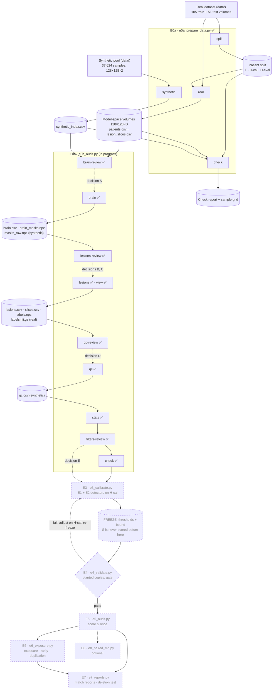
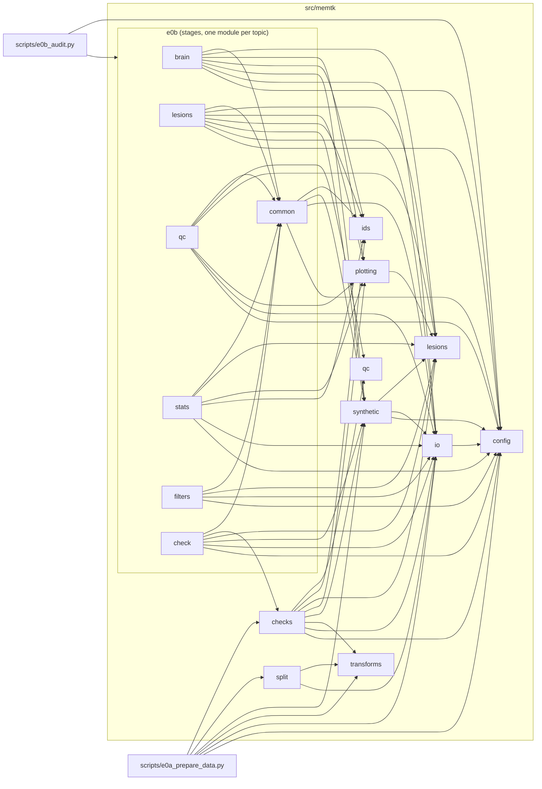

# Architecture

How the project fits together: the experiment pipeline, the code modules, and every file the
pipeline reads or writes. Implemented parts are drawn solid; planned parts dashed and grey.

The diagrams are written in [Mermaid](https://mermaid.js.org/). GitHub renders them directly.
In VS Code, install the extension *Markdown Preview Mermaid Support* (`bierner.markdown-mermaid`)
and open the Markdown preview.

**Keeping it current:** updating this file is part of finishing each experiment, together with
the status table in `scripts/README.md` and the entries in `docs/report-notes.md` and
`docs/process-log.md`.

*Status: E0a and E0b implemented; E0b code restructured into `src/memtk/e0b/` and verified by
a full re-run with identical outputs (2026-11-03).*

---

## 1. Pipeline

One script per experiment; its steps are subcommands (stages). Every stage reads
`configs/default.yaml` (datasets, pools, seed 2026, parameters) and writes a run log next to its
outputs. Cylinders are data products, the diamond is the go/no-go gate. Dotted arrows inside E0b
are decisions you make by hand in the config, after viewing the evidence of a review stage.

| Script | Stage | Status | Reads | Writes |
| --- | --- | --- | --- | --- |
| `e0a_prepare_data.py` | `split` | ✅ | raw real masks | `splits/<dataset>_seed<seed>.csv` |
| | `real` | ✅ | raw real volumes, split CSV | `volumes/`, `patients.csv`, `lesion_slices.csv` |
| | `synthetic` | ✅ | raw synthetic pool, legacy QC list | `synthetic_index.csv` |
| | `check` | ✅ | all of the above, raw data | `check_report_<pool>.txt`, `check_grid_<pool>.png` |
| `e0b_audit.py` | `brain-review` | ✅ | E0a outputs (T only), synthetic pool | `results/<dataset>/e0b/brain_review/` (evidence for decision A) |
| | `brain` | ✅ | decision A, E0a outputs, synthetic pool | `brain.csv`, `brain_masks.npz` (dataset and pool), `masks_raw.npz` (pool), `results/<dataset\|pool>/e0b/brain/` |
| | `lesions-review` | ✅ | E0a outputs, `masks_raw.npz` | `results/<dataset>/e0b/lesions_review/` (evidence for decisions B, C) |
| | `lesions` | ✅ | decisions B, C, `brain` outputs, real `seg` volumes | `lesions.csv`, `slices.csv`, `labels.npz` (dataset and pool), `volumes/<pid>/labels.nii.gz`, `results/<dataset\|pool>/e0b/lesions/` |
| | `view` (helper) | ✅ | lesion outputs | `results/<dataset\|pool>/e0b/views/<key>.png`; with `--nifti`, a synthetic sample's image and labels as NIfTI |
| | `qc-review` | ✅ | `lesions` and `brain` outputs, synthetic index | `results/<pool>/e0b/qc_review/` (evidence for decision D) |
| | `qc` | ✅ | decision D, `lesions` and `brain` outputs | `qc.csv` (pool), `results/<pool>/e0b/qc/` |
| | `stats` | ✅ | `lesions`, `qc`, `brain` outputs, `patients.csv`, real volumes (model space and native masks) | `results/<dataset>/e0b/stats/` |
| | `filters-review` | ✅ | `lesions`, `brain`, `qc` outputs, real `seg` volumes | `results/<dataset>/e0b/filters_review/` (evidence for decision E) |
| | `check` | ✅ | all E0b outputs, synthetic pool | `results/<dataset>/e0b/check_report_<pool>.txt` |
| `e3_calibrate.py` | *tbd* | planned | E0b outputs, H-cal | frozen thresholds |
| `e4_validate.py` | *tbd* | planned | frozen thresholds, T, H-eval | validation table, planted copies |
| `e5_audit.py` | — | planned | frozen thresholds, S | main audit tables |
| `e6_exposure.py` | *tbd* | planned | E5 outputs | exposure, rarity, duplication |
| `e7_reports.py` | *tbd* | planned | E5, E6 outputs, planted copies | match reports, deletion test |
| `e8_paired_mri.py` | — | optional | E5 outputs, paired MRIs | paired-MRI similarity |

E1 (whole-mask detector) and E2 (lesion-level detector) have no scripts: they are `memtk`
modules, run inside E3 (on H-cal), E4 (on planted copies) and E5 (on S).

---

## 2. Code modules

Arrows mean "imports" (taken from the actual imports, 2026-11-03). Two layers:
- **Library modules** (`src/memtk/*.py`): reusable building blocks with no knowledge of stages
  or experiments (labelling, IDs, IO, QC rules, checks, plotting). `config` sits at the bottom:
  it is the only module that knows about the YAML config and the repository root.
- **Stage packages** (`src/memtk/e0b/`, later one per experiment): the stages of one experiment,
  one module per topic; they combine library modules, read and write files. The script in
  `scripts/` is only the command line.

| Module | Purpose | Main functions | External libraries |
| --- | --- | --- | --- |
| `config` | Load the YAML config, look up datasets and pools, resolve paths from the repo root, write run logs | `load_config`, `value` (dotted key), `real_dataset`, `synthetic_pool`, `output_dir`, `results_dir`, `split_file`, `write_run_info` | PyYAML |
| `io` | Read and write NIfTI; locate patients and their files; mask stacks (many 2D boolean masks in one bit-packed `.npz`) and label stacks (many 2D label maps in one sparse `.npz`), looked up by key | `load_image`, `save_nifti`, `read_table` (pipeline CSVs with ID columns kept as text), `list_patients`, `patient_files`, `MaskStackWriter`, `MaskStack`, `LabelStackWriter`, `LabelStack` | nibabel, pandas |
| `ids` | The ID convention shared by every experiment: slice keys (`Mets_005/z127`, sample ID) and lesion IDs (`<slice key>/L<n>`); unique per source, `(source, lesion_id)` globally | `slice_key`, `sample_key`, `parse_slice_key`, `lesion_id`, `parse_lesion_id` | — |
| `transforms` | The original training transform (model space) and slice counts | `model_space_transform`, `convert_volume_pair`, `binarize_mask`, `lesion_px_per_slice` | MONAI, PyTorch |
| `split` | Seeded matched-pair split into T / H-cal / H-eval | `make_split`, `paired_split`, `summarize_split` | pandas |
| `synthetic` | Read synthetic samples in place; sample IDs; index a pool; parse the legacy QC list | `index_pool`, `load_sample`, `sample_id`, `name_scheme`, `read_legacy_exclusions` | — |
| `lesions` | 8-connected labelling; attach-or-drop (specks below the minimum area become strays of a lesion within the gap, or are dropped; lesions numbered by area); lesion features (centroid in three frames, bbox, shape, fraction outside the brain); brain masks (six candidate methods), tissue area, brain box; distance and growing helpers | `label_components`, `count_components`, `attach_or_drop` (→ `LesionLabels`), `speck_gaps`, `lesion_features`, `brain_mask`, `tissue_px`, `brain_box`, `fraction_outside`, `chessboard_distance`, `grow` | SciPy, scikit-image |
| `qc` | Quality classes of synthetic samples: mask class from the mask alone (`no_lesion`, `noisy`, `minor`, `clean`), the combined class with a failed MRI first, the edge count per slice | `mask_class`, `qc_class`, `edge_lesions`, `MASK_CLASSES`, `QC_CLASSES` | pandas |
| `checks` | E0 consistency checks. E0a: split, volumes, independent reference transform, synthetic index, sample grid. E0b: lesion tables vs label maps, label maps vs masks as saved, label volumes, QC table, stack keys, run logs vs the current config | `CheckReport`, `check_split`, `check_real_volumes`, `check_recompute`, `check_synthetic_index`, `sample_grid`, `check_lesion_tables`, `check_labels_vs_masks`, `check_label_volumes`, `check_qc_table`, `check_stack_keys`, `check_run_logs` | PyTorch, matplotlib |
| `plotting` | Shared figure helpers and colours (no pyplot, so importing memtk never changes the plotting backend). `save` wraps the figure title to the figure width and uses the constrained layout, so the title never covers tile titles or runs off the image. `draw_lesions` draws a labelled slice (lesion colours with L-numbers, lighter strays, specks as ×, brain outline and box) | `tile_figure`, `show_slice`, `draw_box`, `hide_unused`, `save`, `draw_lesions`, `lesion_sheet`; colours `BRAIN_COLOR`, `LESION_COLOR`, `BOX_COLOR`, `HIGHLIGHT_COLOR`, `SPECK_COLOR`, `LESION_COLORS`, `SET_COLORS` | matplotlib |

**E0b stage package** (`src/memtk/e0b/`). Every stage function is `run_<stage>(cfg, **options)`,
with the options named like the command-line options; each module has its stages first, then
the computations, tables and figures they use, under section headers.

| Module | Stages (command) | Also contains | 
| --- | --- | --- |
| `e0b.common` | — | `load_real`, `decided`, `refuse_overwrite`, `require`, `pick`, `boxes_of`, `Slices`, `BOX_COLUMNS` |
| `e0b.brain` | `run_brain_review` (`brain-review`, decision A), `run_brain` (`brain`) | `brain_row`, `evaluate_brain_methods`, `threshold_sensitivity`, `summarize_brain_methods`, `propose_brain_method`, `summarize_threshold_sensitivity`, `tissue_counts`, `summarize_brains`, `method_grid`, `sorted_sheet`, `tissue_histogram`, `brain_sheet` |
| `e0b.lesions` | `run_lesions_review` (`lesions-review`, decisions B, C), `run_lesions` (`lesions`), `run_view` (`view`) | `Labeller`, `component_table`, `gap_to_nearest_lesion`, `propose_min_area`, `size_counts`, `mask_specks`, `summarize_attach_or_drop`, `gap_counts`, `summarize_lesions`, `size_figure`, `crop_sheet`, `lesion_view` |
| `e0b.qc` | `run_qc_review` (`qc-review`, decision D), `run_qc` (`qc`) | `SPECK_STRATA`, `speck_stratum`, `summarize_speck_strata`, `summarize_qc` |
| `e0b.stats` | `run_stats` (`stats`) | `adjacency_pairs`, `native_vs_model`, `real_brain_heights`, `describe_sets`, `bound_impact`, `mask_dice`, `brain_by_height`, `cumulative_lines`, the figure functions |
| `e0b.filters` | `run_filters_review` (`filters-review`, decision E) | `FILTERS`, `filter_checks` (also used by E3/E4 to apply decision E), `summarize_filters`, `filter_cost` |
| `e0b.check` | `run_check` (`check`) | `STAGE_KEYS`, `DECISION_KEYS` (the checks themselves are in `memtk.checks`) |

Tests (pytest, on small hand-built inputs): `tests/test_lesions.py` covers labelling,
attach-or-drop (gaps, drop-only, nearest lesion and ties, numbering, nothing moved), lesion
features (all three frames, no brain, partly outside), brain masks, tissue area and the brain
box; `tests/test_io.py` covers the mask- and label-stack round trips and `read_table`;
`tests/test_ids.py` covers building, parsing and refusing IDs; `tests/test_qc.py` covers the
class precedence, the speck cut-off and the edge count; `tests/test_filters.py` covers the
sampling-filter checks; `tests/test_checks.py` runs the E0b consistency checks on consistent
outputs (pass) and on damaged copies (fail: wrong areas, centroids, IDs, counts, numbering,
labels outside the mask, wrong QC class, stale or out-of-order run logs).
Run with `.venv\Scripts\python.exe -m pytest`.

**Planned modules** (from the experiment plan; names may change when each experiment is planned):

| Module | For | Purpose |
| --- | --- | --- |
| `detectors/whole_mask` | E1 | Dice, top-k candidates, shift search |
| `detectors/lesion_level` | E2 | Lesion score s(a, b), Hungarian C(q, t), prefilters, the three output tables |
| `calibration` | E3 | Percentile thresholds, informative-lesion bound |
| `planted` | E4 | Planted-copy variants P1–P6 |
| `stats` | E5, E6 | Bootstrap CIs, Mann-Whitney / AUC, permutation tests |
| `exposure` | E6 | Exposure ratio, rarity, 3D lesion span |
| `reports` | E7 | Match-report figures and verdict lines |

---

## 3. Data dictionary

Placeholders: `<dataset>` = a `real_datasets` entry (now `stanford_brainmets`), `<pool>` = a
`synthetic_pools` entry (now `amibekk_v1`), `<output_root>` = `processed_data/model_space`.
"In git" says whether the file is version-controlled; files that are not can be regenerated
with the stage that writes them.

### Config

| File | Written by | Read by | In git |
| --- | --- | --- | --- |
| `configs/default.yaml` | hand-edited | every stage | yes |

Keys: `seed`; `output_root`, `results_root`, `splits_dir`; `default_real_dataset`,
`default_synthetic_pool`; `preprocessing` (`spatial_size`, `interpolation`, `mask_threshold`,
`slice_axis`); `brain.low_threshold` (data-dependent, checked by `brain-review`); E0b
decisions, `null` until decided: `brain` (`method`, `min_tissue_px`),
`lesions` (`connectivity`, `min_lesion_area`, `attach_gap`), `qc` (`max_isolated_specks`,
`edge_outside_frac`, `small_lesion_px`); `filters` (`max_mask_px`, the sampling script's
pixel-sum limit; `real_sets`, decision E); `real_datasets.<name>` (`root`, `image_file`, `mask_file`, `train_split`,
`heldout_split`, `heldout_sets`); `synthetic_pools.<name>` (`dir`, `glob`, `image_channel`,
`mask_channel`, `trained_on`, `legacy_exclusion_file`).

### Patient split: `splits/<dataset>_seed<seed>.csv`

Written by `split`, read by `real` and `check` (and every later experiment). In git. One row
per patient.

| Column | Meaning |
| --- | --- |
| `patient_id` | Patient folder name, e.g. `Mets_005` |
| `orig_split` | Source folder: `train` or `test` |
| `set` | `T` (training reference), `H-cal` or `H-eval` |
| `n_lesion_slices` | Slices with any lesion voxel, at native resolution |

### Model-space volumes: `<output_root>/<dataset>/volumes/<patient_id>/`

Written by `real`, read by `check` (later: E0b onwards). Not in git. Shape (128, 128, D), with
D = the native number of slices. Identity affine: the array index (i, j, z) is the only
coordinate system, and `z` is 0-based.

| File | dtype | Content |
| --- | --- | --- |
| `bravo.nii.gz` | float32 | MRI after per-volume min-max scaling and area resize, in [0, 1] |
| `seg_soft.nii.gz` | float32 | Mask after the same transform, before thresholding, in [0, 1] |
| `seg.nii.gz` | uint8 | Binary mask: `seg_soft > 0.01` |

### `<output_root>/<dataset>/patients.csv`

Written by `real`, read by `check`. Not in git. One row per patient.

| Column | Meaning |
| --- | --- |
| `patient_id`, `orig_split`, `set` | As in the split CSV (`set` is a copy, checked by `check`) |
| `native_dim0`, `native_dim1` | Native in-plane size (sets how much the slices were squeezed) |
| `n_slices` | Native number of slices = model-space depth D |
| `n_lesion_slices_native`, `n_lesion_slices_model` | Lesion slices before and after conversion |
| `lesion_px_native`, `lesion_px_model` | Total lesion pixels before and after conversion |

### `<output_root>/<dataset>/lesion_slices.csv`

Written by `real`, read by `check` (later: E0b onwards). Not in git. One row per slice with a
lesion in either space.

| Column | Meaning |
| --- | --- |
| `dataset`, `patient_id`, `orig_split`, `set` | Identity of the slice's patient |
| `z` | 0-based slice index = array index in the volume |
| `lesion_px_native`, `lesion_px_model` | Lesion pixels in this slice before and after conversion |

### `<output_root>/<pool>/synthetic_index.csv`

Written by `synthetic`, read by `check` (later: E0b onwards). Not in git. One row per synthetic
file. The files themselves are read in place from the pool folder, never copied.

| Column | Meaning |
| --- | --- |
| `pool` | Pool name from the config |
| `sample_id` | Full file stem; never parse it to a number |
| `filename` | File name in the pool folder |
| `name_scheme` | Naming pattern, e.g. `file_2_<n>` (most likely the generation round) |
| `read_ok` | False if the file could not be read as (H, W, channels) |
| `shape`, `shape_ok` | In-plane shape, and whether it equals `spatial_size` |
| `mask_binary` | Mask values only 0 and 1 |
| `mask_px` | Mask pixels (−1 if unreadable) |
| `n_components_8conn` | 8-connected mask components, before any QC (−1 if unreadable) |
| `img_min`, `img_max`, `img_mean` | Intensity range of the synthetic MRI (NaN if unreadable) |
| `legacy_excluded`, `legacy_reason` | Flag and reason from the old QC list; for comparison only, never a filter |
| `read_error` | Error message if `read_ok` is False; empty otherwise |

### Lesion tables: `<output_root>/<dataset|pool>/lesions.csv`, `slices.csv`, `labels.npz`

Written by `lesions` with the decided `lesions.min_lesion_area` and `lesions.attach_gap`, read
by QC, `stats` and every later experiment. Not in git. Real data: all lesion slices of T, H-cal
and H-eval. Synthetic: every sample, from the mask as saved. IDs follow `memtk.ids`.

`lesions.csv`, one row per lesion:

| Column | Meaning |
| --- | --- |
| `source` | Dataset or pool name; `(source, lesion_id)` is unique across all data |
| `lesion_idx` | Integer row number, for compact joins inside one run (not stable across runs) |
| `lesion_id` | `<slice key>/L<n>`, e.g. `Mets_005/z127/L1`, `file_2_1033/L2` |
| `key` | Slice key (`Mets_005/z127` or the sample ID) |
| `patient_id`, `set`, `z` (real) / `sample_id` (synthetic) | Identity of the slice |
| `label` | Lesion number in the slice, 1 = largest (ties: top-left first) |
| `area`, `stray_px` | Lesion area including attached strays; how many of those pixels are strays |
| `centroid_row`, `centroid_col` | Centroid in model-space pixels |
| `centroid_row_img`, `centroid_col_img` | The same as a fraction of the image size |
| `centroid_row_brain`, `centroid_col_brain` | Brain-relative: 0 at the first, 1 at the last row/column of the brain box; outside [0, 1] beyond the box; NaN without a brain |
| `bbox_r0`, `bbox_r1`, `bbox_c0`, `bbox_c1` | Inclusive bounding box |
| `equiv_diameter`, `eccentricity`, `solidity` | Shape measures (scikit-image regionprops) |
| `frac_outside_brain` | Share of the lesion outside the brain mask (edge check: > `qc.edge_outside_frac`) |

`slices.csv`, one row per slice or sample (identity columns as above, plus):

| Column | Meaning |
| --- | --- |
| `n_components` | All 8-connected components of the mask as saved |
| `n_lesions`, `lesion_px`, `largest_lesion_px` | Lesions after attach-or-drop and their pixels |
| `has_lesion_lt40` | At least one lesion under `qc.small_lesion_px` (the sampling filter's rule) |
| `n_strays`, `stray_px` | Specks attached to a lesion |
| `n_specks`, `speck_px` | Isolated specks, dropped from the label map (counted by QC) |
| `specks_outside_brain` | Isolated specks with more than half their pixels outside the brain |

`labels.npz`: a label stack (`memtk.io.LabelStack`), key = slice key, value = the 128×128 label
map (0 = background or dropped speck, n = lesion `L<n>`, attached strays included).

Real patients also get `volumes/<pid>/labels.nii.gz`: a uint16 label volume (128×128×D) with
each slice's lesion numbers, to open as a segmentation next to `bravo.nii.gz` in ITK-SNAP.
Run logs: `lesions.run_info.json`.

### Results: `results/<dataset>/e0b/lesions/` and `results/<pool>/e0b/lesions/`

Written by `lesions`. In git.

| File | Content |
| --- | --- |
| `summary.txt` | Per set (real) or for the pool: slices, lesions, slices without a lesion, share with a lesion under 40 px, lesion area percentiles, strays, isolated specks (and the share outside the brain), lesions more than half outside the brain |
| `overview.png` | Lesions drawn on their slices: each lesion in its own colour with its L-number, attached strays lighter, dropped specks as orange ×, brain outline cyan, brain box dashed yellow. Real: random T, T with the most lesions, random H-cal and H-eval. Synthetic: random, the most lesions, masks with both strays and isolated specks |
| `run_info.json` | Run log |

### Results: `results/<dataset|pool>/e0b/views/`

Written by the `view` helper, one file per request: `<key>.png` (slice key with `/` replaced by
`_`, e.g. `Mets_120_z40.png`): the slice at full size, drawn as in `overview.png`, with its
`lesions.csv` rows as a table. With `--nifti`, a synthetic sample also gets `<key>_image.nii.gz`
and `<key>_labels.nii.gz` for ITK-SNAP (real slices already have `volumes/<pid>/labels.nii.gz`).

### QC classes: `<output_root>/<pool>/qc.csv`

Written by `qc` with the decided `qc.max_isolated_specks`, read by `stats` and E5. Not in git.
One row per synthetic sample. Flags never exclude; which classes enter the main audit is set
when E5 is planned.

| Column | Meaning |
| --- | --- |
| `source`, `key`, `sample_id` | Identity of the sample |
| `qc_class` | One class with the plan's precedence: `mri_failed` > `no_lesion` > `noisy` > `minor` > `clean` |
| `mask_class` | From the mask alone: `no_lesion` (no lesion), `noisy` (> cut-off isolated specks), `minor` (1..cut-off), `clean` (0). A failed MRI keeps its mask class |
| `mri_failed` | The paired MRI has no brain region (`brain.min_tissue_px`) |
| `edge`, `n_edge_lesions` | Lesions more than `qc.edge_outside_frac` outside the brain (flag only) |
| `has_lesion_lt40` | At least one lesion under `qc.small_lesion_px` (the sampling filter's rule) |
| `n_lesions`, `n_specks`, `n_strays`, `stray_px` | As in `slices.csv` |
| `legacy_excluded` | On the old QC list (comparison only) |

Run log: `qc.run_info.json`.

### Results: `results/<pool>/e0b/qc/`

Written by `qc`. In git.

| File | Content |
| --- | --- |
| `summary.txt` | Counts per QC class and per mask class, failed MRIs by mask class, the old-QC cross-table, the edge check on the real sets |
| `qc_classes_<pool>.csv` | Per QC class: masks, share, edge-flagged, without a lesion under 40 px, strays, on the old QC list |
| `old_qc_crosstab_<pool>.csv` | QC class against the old list's reason (noise fragments, pixels outside brain, not on the list) |
| `edge_check_real_<dataset>.csv` | The same edge rule on T, H-cal and H-eval: slices, lesions, edge lesions, edge slices |
| `qc_classes_<pool>.png` | 8 random samples per QC class, drawn as in the lesion overview |
| `run_info.json` | Run log |

### Results: `results/<dataset>/e0b/stats/`

Written by `stats`. In git. Compares the real sets with a pool, so it lives under the dataset
with the pool name in the file names. Sets: T, H-cal, H-eval, S main (`mask_class` clean or
minor, the main audit) and S all.

| File | Content |
| --- | --- |
| `summary.txt` | The tables below in readable form |
| `description_<pool>.csv` | One column per set: patients, slices, lesions (per slice, max), share of slices with no / one / several lesions, lesion area (quartiles), share with a lesion under 40 px, centroid mean and SD in pixels and brain-relative, slices per patient (real) |
| `native_sizes_<dataset>.csv` | Patients per native in-plane size and set |
| `bound_impact_<pool>.csv` | Per set and candidate informative-lesion bound (5–40 px): lesions kept and their share, slices left without an informative lesion and their share, patients with an informative slice (real). Input for E3 |
| `lesions_per_slice_<pool>.png` | Share of slices by number of lesions, T, H-cal, H-eval, S main |
| `lesion_area_<pool>.png` | Cumulative share of lesions by area (log scale), with medians |
| `centroid_density_<pool>.png` | 2D density of lesion centroids for T, H (H-cal + H-eval) and S main; top row in pixels, bottom row relative to the brain box |
| `adjacency_dice_<dataset>.csv` / `.png` | Per real patient: pairs of consecutive lesion slices and their Dice (median, min, max) on the cleaned masks; histograms of all pairs and of per-patient medians per set |
| `native_vs_model_<dataset>.csv` / `.png` | Per slice with exactly one lesion in both spaces: native area, native area scaled to 128×128 (`expected_area`), model-space area, their `ratio`, native size bin; scatter and ratio by size |
| `brain_by_height_<dataset>.csv` | Brain area quartiles (`p25`, `median`, `p75`) of all real slices (decided brain method) per relative slice position (20 bins, indexed by bin centre; 0 = first, 1 = last slice with brain), with slices and lesion slices per bin |
| `brain_by_height_<pool>.png` | Left: real brain area by relative position (median, middle 50%) with the synthetic median as a red line. Right: brain-area distributions of real lesion slices and synthetic samples (main audit, failed MRIs left out) |
| `run_info.json` | Run log |

### Results: `results/<dataset>/e0b/check_report_<pool>.txt`

Written by `check`. In git. One PASS/FAIL line per check, with counts and failing examples:
every decision set; each production stage's run log has today's values of the settings it
depends on and ran after the stage before it; per source, lesion IDs unique and parseable,
lesion rows per slice, label maps holding labels 1..n with matching areas, centroids and
numbering, label maps reproduced by attach-or-drop from the masks as saved, real
`labels.nii.gz` volumes, stack keys, cached synthetic masks and brain masks recomputed from the
files (random sample), QC classes reproduced and counted; the unit tests. Exit code 1 on any
failure. Run log: `check_<pool>.run_info.json`.

### Results: `results/<dataset>/e0b/filters_review/`

Written by `filters-review`. In git. Evidence for decision E (`filters.real_sets`); nothing here
is used by later stages. The sampling script's filters: `max_mask_px` (pixel sum below
`filters.max_mask_px`), `small_lesion` (a component under `qc.small_lesion_px`), `inside_brain`
(every lesion pixel inside the brain; here with our brain mask, not the script's).

| File | Content |
| --- | --- |
| `review.txt` | The tables below, masks that pass `small_lesion` only because of a speck, the filters that hold in the pool, what to set next |
| `filter_pass_<pool>.csv` | Share of masks passing each filter, on the mask as saved (`raw_*`) and cleaned (`clean_*`), and all three, per set (T, H-cal, H-eval, S main, S all) |
| `filter_cost_<dataset>.csv` | Per real set and filter (cleaned masks): slices removed and their share, patients left |
| `run_info.json` | Run log |

### Results: `results/<pool>/e0b/qc_review/`

Written by `qc-review`. In git. Evidence for decision D (`qc.max_isolated_specks`); nothing here
is used by later stages. Synthetic masks only (no detector has touched S yet).

| File | Content |
| --- | --- |
| `review.txt` | The tables below, proposed cut-off, the edge-check count, what to set next |
| `speck_strata_<pool>.csv` | Per number of isolated specks (0, 1, 2, 3, 4–5, 6–9, 10–19, ≥ 20): masks, share, cumulative share, failed MRIs, masks without a lesion, lesions per mask, share of specks outside the brain, share of lesions with a stray and grown > 25% by strays, share of lesions mostly outside the brain, share excluded by the old QC list |
| `speck_counts_<pool>.csv` | Masks with exactly 0..20 isolated specks, and more |
| `speck_strata_<pool>.png` | 12 random masks per stratum (failed MRIs left out), drawn as in the lesion overview |
| `edge_clean_<pool>.png` | 24 random clean masks with a lesion more than `qc.edge_outside_frac` outside the brain, the lesion named in the tile title |
| `run_info.json` | Run log |

### Results: `results/<dataset>/e0b/lesions_review/`

Written by `lesions-review`. In git. Evidence for decisions B and C; nothing here is used by
later stages. Covers all real lesion slices (T, H-cal, H-eval; the proposal uses T only) and
all synthetic masks as saved.

| File | Content |
| --- | --- |
| `review.txt` | Component sizes, proposed `lesions.min_lesion_area` with its rule, attach-or-drop counts, specks by gap, what to set next |
| `component_sizes_<pool>.csv` / `.png` | Per group: components of each size 1–10 px and larger (table); share by size 1–30 px, log scale, with the proposed minimum marked (figure) |
| `attach_or_drop_<pool>.csv` | Per group, minimum area (proposal ± 1) and gap (0 = drop-only, 1, 2): slices, lesions, slices without lesion, strays and stray px attached, isolated specks, masks with an isolated speck |
| `speck_gaps_<pool>.csv` | Per group: specks at the proposed minimum area by gap to the nearest lesion (1, 2, 3, 4–5, 6–10, ≥ 11 px; or no lesion in the mask) |
| `small_components_T.png` | 32×32 crops of the smallest T components, one row per size 1 to proposal + 1 px; tile title gives slice, size and (row, col) |
| `small_components_T.csv` | Every T component up to proposal + 1 px: `patient_id`, `z`, `key`, `size`, `row`, `col` (model space, first pixel), `gap_to_lesion` (to the nearest other component ≥ proposal; −1 if none), `native_row`, `native_col` (approximate: (index + 0.5) × native size / 128 − 0.5; z is unchanged) |
| `specks_by_gap_<pool>.png` | 32×32 crops of synthetic specks at gap 1, 2 and 3 from a lesion, and T specks at gap 1–3 |
| `run_info.json` | Run log |

### Brain masks: `<output_root>/<dataset>/brain.csv` and `<output_root>/<pool>/brain.csv`

Written by `brain` with the decided `brain.method`, read by later E0b stages. Not in git. One row
per real lesion slice (all sets) or per readable synthetic sample.

| Column | Meaning |
| --- | --- |
| `key` (real) | Slice key `<patient_id>/z<z>`, e.g. `Mets_005/z127`; the key in `brain_masks.npz` |
| `patient_id`, `set`, `z` (real) | Identity of the slice |
| `sample_id` (synthetic) | Full file stem; the key in `brain_masks.npz` and `masks_raw.npz` |
| `brain_px` | Area of the brain mask |
| `tissue_px` | Brain tissue area (`memtk.lesions.tissue_px`; equals `brain_px` with `low_threshold_all`) |
| `box_r0`, `box_r1`, `box_c0`, `box_c1` | Inclusive brain box (rows, columns); −1 if the slice has no brain |
| `mri_failed` (synthetic) | `tissue_px < brain.min_tissue_px`: a near-blank MRI without brain |

### Mask stacks: `brain_masks.npz`, `masks_raw.npz`

Written by `brain`, read with `memtk.io.MaskStack` (`stack[key]` gives a boolean 128×128 mask).
Not in git. Arrays `keys`, `packed` (1 bit per pixel) and `shape`.

| File | Keys | Content |
| --- | --- | --- |
| `<output_root>/<dataset>/brain_masks.npz` | `<patient_id>/z<z>` | Brain mask of every lesion slice |
| `<output_root>/<pool>/brain_masks.npz` | `sample_id` | Brain mask of every synthetic sample |
| `<output_root>/<pool>/masks_raw.npz` | `sample_id` | The synthetic mask as saved (binary, specks included); never modified |

Run logs next to them: `brain.run_info.json`.

### Results: `results/<dataset>/e0b/brain/` and `results/<pool>/e0b/brain/`

Written by `brain`. In git.

| File | Content |
| --- | --- |
| `summary.txt` | Per set (real) or per failed/ok group (synthetic): slices, slices without brain, brain-area 1st/5th percentile and median, median box size; failed-MRI count |
| `outlines.png` | Brain outline (cyan), box (dashed yellow) and mask (red). Real: random lesion slices per set. Synthetic: random samples, the smallest non-failed brains, failed MRIs |
| `run_info.json` | Run log |

### Results: `results/<dataset>/e0a/`

Written by `check`. In git.

| File | Content |
| --- | --- |
| `check_report_<pool>.txt` | One PASS/FAIL line per check, with counts and failing examples |
| `check_grid_<pool>.png` | Random lesion slices of T, H-cal and H-eval, and random synthetic samples, with mask outlines |
| `check_<pool>.run_info.json` | Run log |

### Results: `results/<dataset>/e0b/brain_review/`

Written by `brain-review`. In git. Evidence for decision A; nothing here is used by later stages.

| File | Content |
| --- | --- |
| `review.txt` | Threshold sensitivity (does `brain.low_threshold` sit in a gap?), method comparison, proposed `brain.method` with its rule, tissue-cut counts, what to set next |
| `threshold_sensitivity_<pool>.csv` | Per group (T, S sample) and multiple of `brain.low_threshold` (0.25–3×): slices, median and 95th-percentile absolute change of the brain area |
| `brain_methods_<pool>.csv` | Per group (T, S sample) and method: lesions (≥ provisional min area), share more than half outside / partly outside the brain, brain-area 1st/5th percentile and median |
| `methods_real.png` | T slices where plain Otsu fails, plus random ones; one column per method; cyan = brain, red = lesion |
| `methods_synthetic_<pool>.png` | The same for small synthetic brains, synthetic lesions outside, and random samples |
| `near_blank_<pool>.png` | Synthetic MRIs with the least brain tissue, samples just above candidate cuts, and the T slices with the least tissue |
| `tissue_hist_<pool>.png` | Tissue area of all synthetic samples vs T lesion slices (log axes) |
| `tissue_counts_<pool>.csv` | For each candidate `min_tissue_px`: synthetic samples below it, and T lesion slices below it |
| `run_info.json` | Run log |

### Run logs: `run_info.json` and `*.run_info.json`

Written by every stage next to its outputs. Fields: `timestamp`, `script`, `argv`, `seed`,
`python`, `packages` (versions of memtk, numpy, scipy, scikit-image, nibabel, monai, torch,
pandas), `config` (the full config used), and stage-specific extras such as `stage` and `pool`.
