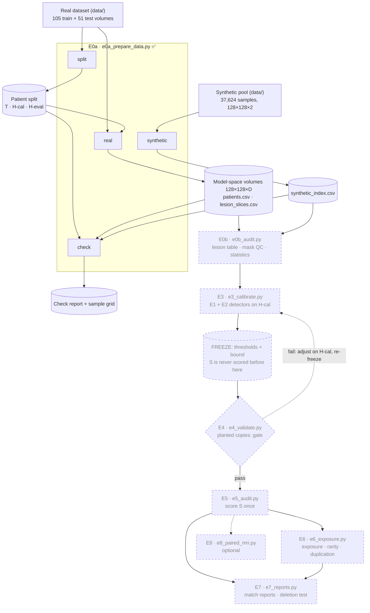
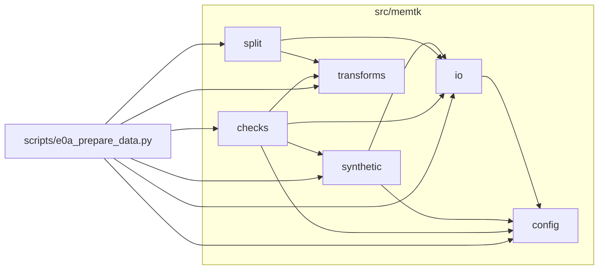

# Architecture

How the project fits together: the experiment pipeline, the code modules, and every file the
pipeline reads or writes. Implemented parts are drawn solid; planned parts dashed and grey.

The diagrams are written in [Mermaid](https://mermaid.js.org/). GitHub renders them directly.
In VS Code, install the extension *Markdown Preview Mermaid Support* (`bierner.markdown-mermaid`)
and open the Markdown preview.

**Keeping it current:** updating this file is part of finishing each experiment, together with
the status table in `scripts/README.md` and the entries in `docs/report-notes.md`.

*Status: E0a implemented (2026-11-01).*

---

## 1. Pipeline

One script per experiment; its steps are subcommands (stages). Every stage reads
`configs/default.yaml` (datasets, pools, seed 2026, parameters) and writes a run log next to its
outputs. Cylinders are data products, the diamond is the go/no-go gate.

| Script | Stage | Status | Reads | Writes |
| --- | --- | --- | --- | --- |
| `e0a_prepare_data.py` | `split` | ✅ | raw real masks | `splits/<dataset>_seed<seed>.csv` |
| | `real` | ✅ | raw real volumes, split CSV | `volumes/`, `patients.csv`, `lesion_slices.csv` |
| | `synthetic` | ✅ | raw synthetic pool, legacy QC list | `synthetic_index.csv` |
| | `check` | ✅ | all of the above, raw data | `check_report_<pool>.txt`, `check_grid_<pool>.png` |
| `e0b_audit.py` | *tbd* | planned | E0a outputs | lesion table, QC classes, E0 statistics |
| `e3_calibrate.py` | *tbd* | planned | E0b outputs, H-cal | frozen thresholds |
| `e4_validate.py` | *tbd* | planned | frozen thresholds, T, H-eval | validation table, planted copies |
| `e5_audit.py` | — | planned | frozen thresholds, S | main audit tables |
| `e6_exposure.py` | *tbd* | planned | E5 outputs | exposure, rarity, duplication |
| `e7_reports.py` | *tbd* | planned | E5, E6 outputs, planted copies | match reports, deletion test |
| `e8_paired_mri.py` | — | optional | E5 outputs, paired MRIs | paired-MRI similarity |

E1 (whole-mask detector) and E2 (lesion-level detector) have no scripts: they are `memtk`
modules, run inside E3 (on H-cal), E4 (on planted copies) and E5 (on S).

---

## 2. Code modules

Arrows mean "imports". `config` sits at the bottom: it is the only module that knows about the
YAML config and the repository root.

| Module | Purpose | Main functions | External libraries |
| --- | --- | --- | --- |
| `config` | Load the YAML config, look up datasets and pools, resolve paths from the repo root, write run logs | `load_config`, `real_dataset`, `synthetic_pool`, `output_dir`, `results_dir`, `split_file`, `write_run_info` | PyYAML |
| `io` | Read and write NIfTI; locate patients and their files | `load_image`, `save_nifti`, `list_patients`, `patient_files` | nibabel |
| `transforms` | The original training transform (model space) and slice counts | `model_space_transform`, `convert_volume_pair`, `binarize_mask`, `lesion_px_per_slice` | MONAI, PyTorch |
| `split` | Seeded matched-pair split into T / H-cal / H-eval | `make_split`, `paired_split`, `summarize_split` | pandas |
| `synthetic` | Read synthetic samples in place; sample IDs; index a pool; parse the legacy QC list | `index_pool`, `load_sample`, `sample_id`, `name_scheme`, `read_legacy_exclusions`, `count_components` | SciPy |
| `checks` | E0a consistency checks, independent reference transform, sample grid | `CheckReport`, `check_split`, `check_real_volumes`, `check_recompute`, `check_synthetic_index`, `sample_grid` | PyTorch, matplotlib |

**Planned modules** (from the experiment plan; names may change when each experiment is planned):

| Module | For | Purpose |
| --- | --- | --- |
| `lesions` | E0b | 8-connected labelling, attach-or-drop, lesion features, brain box. Takes over `count_components` from `synthetic`. |
| `qc` | E0b | Synthetic mask quality classes (clean / minor / noisy) |
| `detectors/whole_mask` | E1 | Dice, top-k candidates, shift search |
| `detectors/lesion_level` | E2 | Lesion score s(a, b), Hungarian C(q, t), prefilters, the three output tables |
| `calibration` | E3 | Percentile thresholds, informative-lesion bound |
| `planted` | E4 | Planted-copy variants P1–P6 |
| `stats` | E5, E6 | Bootstrap CIs, Mann-Whitney / AUC, permutation tests |
| `exposure` | E6 | Exposure ratio, rarity, 3D lesion span |
| `reports` | E7 | Match-report figures and verdict lines |

---

## 3. Data dictionary

Placeholders: `<dataset>` = a `real_datasets` entry (now `stanford_brainmets`), `<pool>` = a
`synthetic_pools` entry (now `amibekk_v1`), `<output_root>` = `processed_data/model_space`.
"In git" says whether the file is version-controlled; files that are not can be regenerated
with the stage that writes them.

### Config

| File | Written by | Read by | In git |
| --- | --- | --- | --- |
| `configs/default.yaml` | hand-edited | every stage | yes |

Keys: `seed`; `output_root`, `results_root`, `splits_dir`; `default_real_dataset`,
`default_synthetic_pool`; `preprocessing` (`spatial_size`, `interpolation`, `mask_threshold`,
`slice_axis`); `real_datasets.<name>` (`root`, `image_file`, `mask_file`, `train_split`,
`heldout_split`, `heldout_sets`); `synthetic_pools.<name>` (`dir`, `glob`, `image_channel`,
`mask_channel`, `trained_on`, `legacy_exclusion_file`).

### Patient split: `splits/<dataset>_seed<seed>.csv`

Written by `split`, read by `real` and `check` (and every later experiment). In git. One row
per patient.

| Column | Meaning |
| --- | --- |
| `patient_id` | Patient folder name, e.g. `Mets_005` |
| `orig_split` | Source folder: `train` or `test` |
| `set` | `T` (training reference), `H-cal` or `H-eval` |
| `n_lesion_slices` | Slices with any lesion voxel, at native resolution |

### Model-space volumes: `<output_root>/<dataset>/volumes/<patient_id>/`

Written by `real`, read by `check` (later: E0b onwards). Not in git. Shape (128, 128, D), with
D = the native number of slices. Identity affine: the array index (i, j, z) is the only
coordinate system, and `z` is 0-based.

| File | dtype | Content |
| --- | --- | --- |
| `bravo.nii.gz` | float32 | MRI after per-volume min-max scaling and area resize, in [0, 1] |
| `seg_soft.nii.gz` | float32 | Mask after the same transform, before thresholding, in [0, 1] |
| `seg.nii.gz` | uint8 | Binary mask: `seg_soft > 0.01` |

### `<output_root>/<dataset>/patients.csv`

Written by `real`, read by `check`. Not in git. One row per patient.

| Column | Meaning |
| --- | --- |
| `patient_id`, `orig_split`, `set` | As in the split CSV (`set` is a copy, checked by `check`) |
| `native_dim0`, `native_dim1` | Native in-plane size (sets how much the slices were squeezed) |
| `n_slices` | Native number of slices = model-space depth D |
| `n_lesion_slices_native`, `n_lesion_slices_model` | Lesion slices before and after conversion |
| `lesion_px_native`, `lesion_px_model` | Total lesion pixels before and after conversion |

### `<output_root>/<dataset>/lesion_slices.csv`

Written by `real`, read by `check` (later: E0b onwards). Not in git. One row per slice with a
lesion in either space.

| Column | Meaning |
| --- | --- |
| `dataset`, `patient_id`, `orig_split`, `set` | Identity of the slice's patient |
| `z` | 0-based slice index = array index in the volume |
| `lesion_px_native`, `lesion_px_model` | Lesion pixels in this slice before and after conversion |

### `<output_root>/<pool>/synthetic_index.csv`

Written by `synthetic`, read by `check` (later: E0b onwards). Not in git. One row per synthetic
file. The files themselves are read in place from the pool folder, never copied.

| Column | Meaning |
| --- | --- |
| `pool` | Pool name from the config |
| `sample_id` | Full file stem; never parse it to a number |
| `filename` | File name in the pool folder |
| `name_scheme` | Naming pattern, e.g. `file_2_<n>` (most likely the generation round) |
| `read_ok` | False if the file could not be read as (H, W, channels) |
| `shape`, `shape_ok` | In-plane shape, and whether it equals `spatial_size` |
| `mask_binary` | Mask values only 0 and 1 |
| `mask_px` | Mask pixels (−1 if unreadable) |
| `n_components_8conn` | 8-connected mask components, before any QC (−1 if unreadable) |
| `img_min`, `img_max`, `img_mean` | Intensity range of the synthetic MRI (NaN if unreadable) |
| `legacy_excluded`, `legacy_reason` | Flag and reason from the old QC list; for comparison only, never a filter |
| `read_error` | Error message if `read_ok` is False; empty otherwise |

### Results: `results/<dataset>/e0a/`

Written by `check`. In git.

| File | Content |
| --- | --- |
| `check_report_<pool>.txt` | One PASS/FAIL line per check, with counts and failing examples |
| `check_grid_<pool>.png` | Random lesion slices of T, H-cal and H-eval, and random synthetic samples, with mask outlines |
| `check_<pool>.run_info.json` | Run log |

### Run logs: `run_info.json` and `*.run_info.json`

Written by every stage next to its outputs. Fields: `timestamp`, `script`, `argv`, `seed`,
`python`, `packages` (versions of memtk, numpy, scipy, scikit-image, nibabel, monai, torch,
pandas), `config` (the full config used), and stage-specific extras such as `stage` and `pool`.
